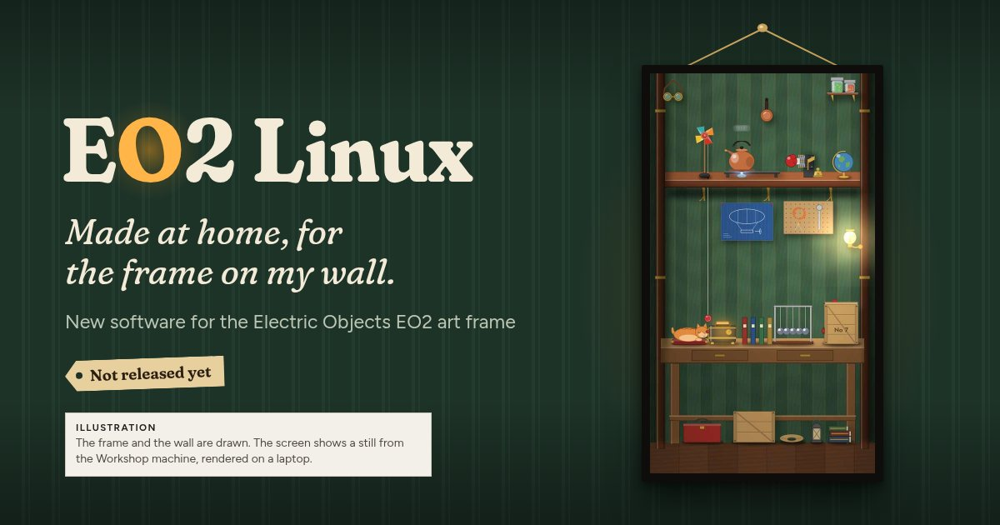

# EO2 Linux

*Made at home, for the frame on my wall.*

New software for the Electric Objects EO2, a wall-hung art frame from 2016. The EO2 relied on the company's servers and stopped working when they went away. EO2 Linux runs on the frame without them and needs no account. You control it from a phone on your home Wi-Fi.

**Not released yet.** The code, the installer and the art catalog aren't public. This repository holds only the showcase pages and their pictures.

- **[The overview](https://auntiepickle.github.io/eo2-linux-showcase/)**: what the frame shows, in a few screens.
- **[All the details](https://auntiepickle.github.io/eo2-linux-showcase/more.html)**: the art and its credits, clocks, machines and games, location and filters, the phone app, adding your own, the install and the status.

In the picture above, the frame and the wall are drawn. The screen shows a still from the Workshop machine, rendered on a laptop.

## Status

- The installer has run end to end from a Linux computer. From Windows, Bluetooth contact works but the Wi-Fi hand-over hasn't been run. From a Mac, Bluetooth hasn't been tried on a real frame.
- Only the EO2 is supported. The EO1 is different hardware.
- When the code and the catalog are public, this page and the showcase will link to them.

## Full-size files

[Stills](media/stills), [videos](media/video-hd), [GIFs](media/gif) and [wall pictures](media/mockups).

- The stills are screen captures from my frame, except the three clock faces (`eo2-clock-*`), which were rendered on a laptop at a made-up time and date. The art was captured with the Gallery light filter on.
- The videos and GIFs were rendered on a laptop from the frame's scene code, with a made-up time and weather.
- In the wall pictures the frames and the wall are drawn. The screens are captures from my frame, except the clock in the three-frame picture, which was rendered on a laptop.

## Credits

The art shown is in the public domain: CC0 images from the Art Institute of Chicago and The Metropolitan Museum of Art. The scenes, clocks and games are original work for EO2 Linux. Weather comes from [Open-Meteo.com](https://open-meteo.com/), whose data is licensed CC BY 4.0. EO2 Linux builds on the community Android launcher for Electric Objects frames ([aphex3k/EO1](https://github.com/aphex3k/EO1)) and keeps its HTTP API.

The pages are set in Fraunces and Figtree, served from [`fonts/`](fonts) under the SIL Open Font License 1.1, with the licence files beside them.

EO2 Linux is an independent project by an EO2 owner. It is not affiliated with or endorsed by Electric Objects or Giphy. Electric Objects and EO2 are trademarks of their owners.
